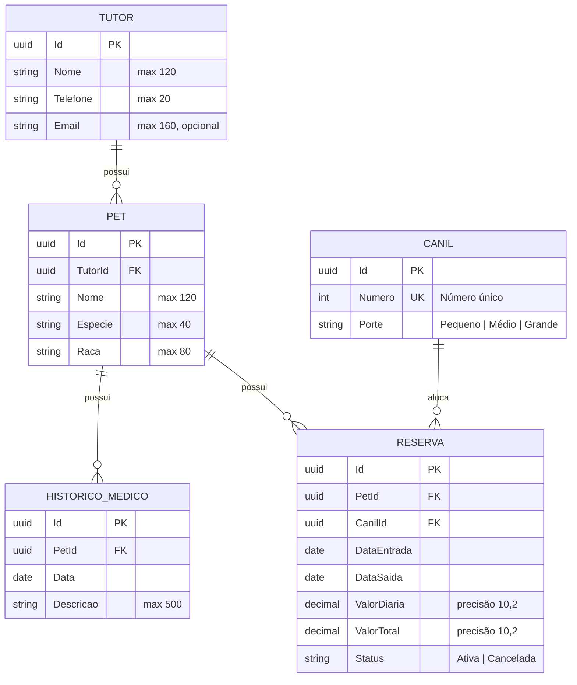

# PetzIn

## Tecnologias Escolhidas e Motivações

### **Backend**

- **.NET 10 (ASP.NET Core Web API):** Plataforma moderna de alta performance, tipagem estática robusta, excelente ecossistema corporativo e injeção de dependência nativa.
- **Entity Framework Core 10:** ORM produtivo com suporte a migrações Code-First, consultas LINQ tipadas e controle transacional confiável com PostgreSQL.
- **Npgsql Entity Framework Core PostgreSQL:** Driver e provedor oficial otimizado para integração entre .NET e PostgreSQL.
- **Swashbuckle (Swagger/OpenAPI):** Geração automática de documentação interativa para exploração e teste dos endpoints da API.

### **Frontend**

- **Angular 21 (v21.2):** Framework escalável e robusto baseado em componentes *standalone*, nova reatividade e tipagem estrita com TypeScript.
- **Tailwind CSS v4:** Framework CSS utilitário para estilização rápida, responsiva e consistente com baixo overhead de CSS final.
- **Nginx (Alpine):** Servidor web de alta performance usado na imagem conteinerizada do frontend, atuando também como **proxy reverso** para redirecionar chamadas `/api/` e `/swagger` para o backend, eliminando problemas de CORS.

### **Banco de Dados**

- **PostgreSQL 16:** SGDB relacional confiável com conformidade ACID, garantindo integridade referencial, bloqueio de conflitos e suporte a índices exclusivos (ex.: unicidade do número do canil).

### **Infraestrutura e Containerização**

- **Docker & Docker Compose:** Orquestração declarativa que sobe a aplicação completa (banco, backend e frontend com proxy) com apenas um comando, sem exigir a instalação manual de SDKs na máquina do desenvolvedor.

---

## Documentação da Análise

### 1. Análise de Domínio e Regras de Negócio

O sistema foi concebido para resolver os desafios operacionais do gerenciamento de uma hospedagem pet:

- **Tutores:** Registro central de tutores com validação de telefone obrigatório e formato de e-mail válido. Proteção de integridade: um tutor não pode ser excluído se tiver pets vinculados.
- **Pets e Histórico Médico:** Cada pet pertence obrigatoriamente a um tutor. O pet mantém um histórico médico cronológico (vacinas, intervenções, orientações). Um pet não pode ser excluído caso possua histórico médico ou reservas registradas.
- **Canis (Acomodações):** Canis identificados por número único e categorizados por porte (*Pequeno*, *Médio*, *Grande*). Não podem ser excluídos se possuírem reservas no sistema.
- **Reservas de Estadias:**
  - **Validação temporal:** A data de saída deve ser estritamente posterior à data de entrada.
  - **Cálculo de valores:** O valor total é calculado dinamicamente no backend: `ValorTotal = ValorDiaria * (DataSaida - DataEntrada)`.
  - **Prevenção de conflito de ocupação:** Para reservas com status `Ativa`, o sistema valida se o canil já possui outra reserva ativa no mesmo intervalo, aplicando a regra de sobreposição:
    $$\text{DataEntrada}_{\text{existente}} < \text{DataSaida}_{\text{nova}} \quad \land \quad \text{DataSaida}_{\text{existente}} > \text{DataEntrada}_{\text{nova}}$$
  - **Ciclo de status:** Reservas podem alternar entre `Ativa` e `Cancelada`.

### 2. Análise Arquitetural e Decisões de Engenharia

- **Monorepo Estruturado:** Separação limpa entre `backend/` e `frontend/`, mantendo um ciclo de desenvolvimento integrado via `docker-compose.yml`.
- **Arquitetura em Camadas (Backend):**
  - **Controllers:** Apenas recepção de requisições, delegação para serviços e retorno de códigos de status HTTP semânticos (200, 201, 204, 400, 404, 409).
  - **Services:** Centralização de 100% das regras de negócio, validações e consultas LINQ.
  - **DTOs:** Isolamento entre os modelos de persistência (`Models`) e os contratos expostos na API (`Requests` e `Responses`).
  - **Tratamento Centralizado de Erros:** O `ErroMiddleware` intercepta exceções do tipo `AppException` e erros não tratados, gerando respostas padronizadas em JSON com código de status e mensagem legível.
- **Resiliência e Inicialização Automática:**
  - No `Program.cs`, o backend executa automaticamente as migrações (`db.Database.Migrate()`) e o `DbSeeder.Seed(db)` em um loop de retry, aguardando o PostgreSQL estar pronto para conexões.
- **Proxy Reverso Integrado:** O Nginx do frontend serve o Single Page Application (SPA) e faz proxy das rotas `/api/` e `/swagger` para o serviço de API, unificando a experiência no navegador sob a mesma porta (`8080`).

---

## Diagrama do Banco de Dados



---

## Diagrama da Estrutura de Pastas e Arquivos

```mermaid
flowchart TD
    ROOT["petzin/ (Raiz do Projeto)"]

    ROOT --> DOCKER_COMPOSE["docker-compose.yml"]
    ROOT --> README_FILE["README.md"]
    ROOT --> BACKEND_DIR["backend/"]
    ROOT --> FRONTEND_DIR["frontend/"]

    subgraph Backend_Tree [Backend - ASP.NET Core]
        BACKEND_DIR --> B_DOCKER["Dockerfile"]
        BACKEND_DIR --> API_PROJ["Petzin.Api/"]

        API_PROJ --> CONTROLLERS["Controllers/ (Canis, Pets, Reservas, Tutores)"]
        API_PROJ --> SERVICES["Services/ (Regras de negócio e validações)"]
        API_PROJ --> MODELS["Models/ (Entidades EF Core)"]
        API_PROJ --> DTOS["Dtos/ (Contratos Request/Response)"]
        API_PROJ --> DATA["Data/ (AppDbContext, DbSeeder, Migrations/)"]
        API_PROJ --> ERROS["Erros/ (AppException, ErroMiddleware)"]
        API_PROJ --> B_PROG["Program.cs (Configuração de DI, Swagger e pipeline)"]
        API_PROJ --> B_CSPROJ["Petzin.Api.csproj"]
    end

    subgraph Frontend_Tree [Frontend - Angular 21]
        FRONTEND_DIR --> F_DOCKER["Dockerfile (Build multi-stage Node + Nginx)"]
        FRONTEND_DIR --> NGINX_CONF["nginx.conf (Proxy reverso /api e /swagger)"]
        FRONTEND_DIR --> F_PKG["package.json"]
        FRONTEND_DIR --> SRC["src/"]

        SRC --> APP["app/"]
        APP --> FEAT["features/ (canis, pets, reservas, tutores)"]
        APP --> F_SERVICES["services/ (Integração HTTP com a API)"]
        APP --> F_SHARED["shared/ (Componentes e utilitários compartilhados)"]
        APP --> F_ROUTES["app.routes.ts (Roteamento da SPA)"]
        APP --> F_CONFIG["app.config.ts (Provedores de rotas e HTTP)"]
    end
```



---

## Explicação Técnica dos Pontos Centrais da Estrutura

### **1. Backend (`backend/Petzin.Api`)**

- **`Controllers/`:** Controladores REST (`TutoresController`, `PetsController`, `CanisController`, `ReservasController`). Mapeiam as rotas HTTP e delegam imediatamente para a camada de serviço.
- **`Services/`:** O núcleo de domínio (`TutorService`, `PetService`, `CanilService`, `ReservaService`). Contêm a lógica de cálculo de diárias, verificação de sobreposição de reservas de canis, checagem de integridade referencial antes de exclusões e mapeamentos entre Models e DTOs.
- **`Dtos/`:** `Record types` imutáveis que blindam as entidades de domínio contra *overposting* e simplificam as respostas HTTP.
- **`Data/`:**
  - `AppDbContext`: Configurações de constraints do banco (tamanhos máximos, precisão de moedas, índices únicos e relações de chave estrangeira com `DeleteBehavior.Restrict`).
  - `DbSeeder`: Popula o banco com dados iniciais (tutores, pets, canis, histórico e reservas) de forma idempotente logo no primeiro boot.
  - `Migrations/`: Histórico versionado de alterações do esquema do banco de dados.
- **`Erros/`:**
  - `AppException`: Exceção personalizada com código HTTP de status.
  - `ErroMiddleware`: Middleware global registrado no pipeline do ASP.NET Core que padroniza erros e evita vazamento de *stack traces*.

### **2. Frontend (`frontend/src/app`)**

- **`features/`:** Cada funcionalidade principal possui seu próprio módulo conceitual com componentes standalone:
  - `tutores/`: Listagem e formulário de cadastro/edição de tutores.
  - `pets/`: Listagem de pets, formulário de cadastro e modal de histórico médico.
  - `canis/`: Gerenciamento de acomodações e portes.
  - `reservas/`: Painel de reservas, seleção de datas, cálculo automático e cancelamento.
- **`services/`:** Serviços Angular que injetam o `HttpClient` para comunicação REST com o backend (`/api/*`).
- **`nginx.conf`:** Roteia requisições locais: páginas SPA retornam `index.html` (HTML5 history mode) e chamadas `/api/` e `/swagger` são encaminhadas para o container da API.

---

## Endpoints da API e Swagger

A documentação interativa Swagger/OpenAPI está disponível diretamente pelo navegador em:

- **Via Proxy (Porta Padrão):** [http://localhost:8080/swagger](http://localhost:8080/swagger)
- **Acesso Direto à API:** [http://localhost:5000/swagger](http://localhost:5000/swagger)

### Resumo dos Endpoints Principais

| Módulo | Método | Rota | Descrição |
| :--- | :--- | :--- | :--- |
| **Health** | `GET` | `/api/health` | Verificação de status da API |
| **Tutores** | `GET` | `/api/tutores` | Lista todos os tutores cadastrados |
| | `GET` | `/api/tutores/{id}` | Obtém detalhes de um tutor |
| | `POST` | `/api/tutores` | Cadastra um novo tutor |
| | `PUT` | `/api/tutores/{id}` | Atualiza dados de um tutor existente |
| | `DELETE` | `/api/tutores/{id}` | Remove um tutor (se não possuir pets) |
| **Pets** | `GET` | `/api/pets` | Lista todos os pets |
| | `GET` | `/api/pets/{id}` | Obtém detalhes de um pet |
| | `POST` | `/api/pets` | Cadastra um novo pet associado a um tutor |
| | `PUT` | `/api/pets/{id}` | Atualiza dados de um pet |
| | `DELETE` | `/api/pets/{id}` | Remove um pet (se não possuir reservas/histórico) |
| **Histórico** | `GET` | `/api/pets/{id}/historicos` | Lista o histórico médico de um pet |
| | `POST` | `/api/pets/{id}/historicos` | Adiciona um registro no histórico médico |
| **Canis** | `GET` | `/api/canis` | Lista todos os canis |
| | `GET` | `/api/canis/{id}` | Obtém detalhes de um canil |
| | `POST` | `/api/canis` | Cadastra um canil com número único e porte |
| | `PUT` | `/api/canis/{id}` | Atualiza um canil |
| | `DELETE` | `/api/canis/{id}` | Remove um canil (se não possuir reservas) |
| **Reservas** | `GET` | `/api/reservas` | Lista todas as reservas ordenadas por data |
| | `GET` | `/api/reservas/{id}` | Obtém detalhes de uma reserva |
| | `POST` | `/api/reservas` | Cria reserva com validação de conflito de datas |
| | `PUT` | `/api/reservas/{id}` | Atualiza reserva |
| | `DELETE` | `/api/reservas/{id}` | Remove uma reserva |

---

## Como Instalar Dependências e Rodar o Projeto

Você pode executar o projeto de duas maneiras: **usando Docker Compose (recomendado)** ou **manualmente em sua máquina**.

---

### Opção 1: Execução com Docker Compose (Recomendada)

Não é necessário instalar .NET, Node.js ou PostgreSQL localmente. Apenas o **Docker** e o **Docker Compose** são necessários.

#### 1. Pré-requisitos

- [Docker](https://www.docker.com/) instalado e em execução (Docker Desktop no Windows/macOS ou Docker Engine no Linux).

#### 2. Subir os containers

Na raiz do projeto (`c:\Users\Pichau\projects\petzin`), execute:

```bash
docker compose up --build
```

O comando irá:

1. Subir o container do banco **PostgreSQL 16** e aguardar o healthcheck.
2. Compilar e iniciar a **API .NET 10** (aplicando automaticamente as migrações e o seed de dados).
3. Construir a aplicação **Angular** e iniciar o **Nginx**.

#### 3. Acessar a aplicação

- **Aplicação Web (Frontend):** [http://localhost:8080](http://localhost:8080)
- **Documentação Swagger (via Nginx):** [http://localhost:8080/swagger](http://localhost:8080/swagger)
- **Acesso direto à API:** [http://localhost:5000/swagger](http://localhost:5000/swagger)

#### 4. Encerrar os serviços

Para parar e remover os containers:

```bash
docker compose down
```

> **Dica:** Para resetar o banco e aplicar novamente o seed inicial limpo, adicione o parâmetro `-v` para remover os volumes persistentes:
>
> ```bash
> docker compose down -v
> ```

---

### Opção 2: Execução Manual Local (Sem Docker para Backend/Frontend)

Caso queira rodar os serviços diretamente na sua máquina para desenvolvimento:

#### 1. Pré-requisitos

- [.NET SDK 10.0](https://dotnet.microsoft.com/)
- [Node.js 22+](https://nodejs.org/) e [npm](https://www.npmjs.com/)
- [PostgreSQL 16](https://www.postgresql.org/) (ou rode apenas o banco pelo Docker)

#### 2. Iniciar o Banco de Dados PostgreSQL

Você pode subir apenas o serviço do PostgreSQL usando o Docker:

```bash
docker compose up -d postgres
```

*(Ou utilize uma instância local do PostgreSQL configurando as credenciais no arquivo `backend/Petzin.Api/appsettings.Development.json`).*

#### 3. Iniciar o Backend (.NET)

Abra um terminal e acesse a pasta do backend:

```bash
cd backend/Petzin.Api
dotnet restore
dotnet run
```

A API iniciará por padrão em `http://localhost:5000` (ou porta configurada em `launchSettings.json`), aplicando automaticamente as migrações e o seed no banco de dados.

#### 4. Iniciar o Frontend (Angular)

Abra um segundo terminal e acesse a pasta do frontend:

```bash
cd frontend
npm install
npm start
```

A interface estará disponível em:

- [http://localhost:4200](http://localhost:4200)

*(Nota: Na execução via `ng serve`, configure o proxy do Angular CLI ou garanta que as requisições apontem para a porta do backend em execução).*
